# Backend – Gestão de Consumo de Energia

## Descrição
Backend desenvolvido em Node.js e MariaDB para registrar equipamentos e locais, acompanhar o consumo de energia elétrica e identificar possíveis desperdícios.

O sistema permite cadastrar usuários, realizar login, registrar consumos de energia, consultar equipamentos e locais, atualizar e excluir registros e calcular a média de consumo em kWh.

## Diagrama de Classes

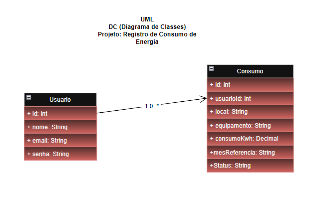

## Tecnologias utilizadas
- Node.js
- Express
- MariaDB
- MySQL2
- JavaScript
- Insomnia
- Draw.io

## Instalação e execução

1. Instale as dependências:
   `npm install`

2. Execute o script `db/script.sql` no MariaDB.

3. Inicie o servidor:
   `node server.js`

4. A API estará disponível em:
   `http://localhost:3000`

## Rotas da API

### Usuários
- POST `/usuarios` – Cadastrar usuário.
- GET `/usuarios` – Listar usuários.
- GET `/usuarios/:id` – Buscar usuário por ID.
- PUT `/usuarios/:id` – Atualizar usuário.
- DELETE `/usuarios/:id` – Excluir usuário.
- POST `/login` – Realizar login.

### Consumo
- POST `/consumo` – Cadastrar consumo.
- GET `/consumo` – Listar consumos.
- GET `/consumo/:id` – Buscar consumo por ID.
- PUT `/consumo/:id` – Atualizar consumo.
- DELETE `/consumo/:id` – Excluir consumo.
- GET `/consumo/media` – Calcular média de consumo em kWh.

## Testes realizados no Insomnia

### Usuários

1. Cadastrar usuário

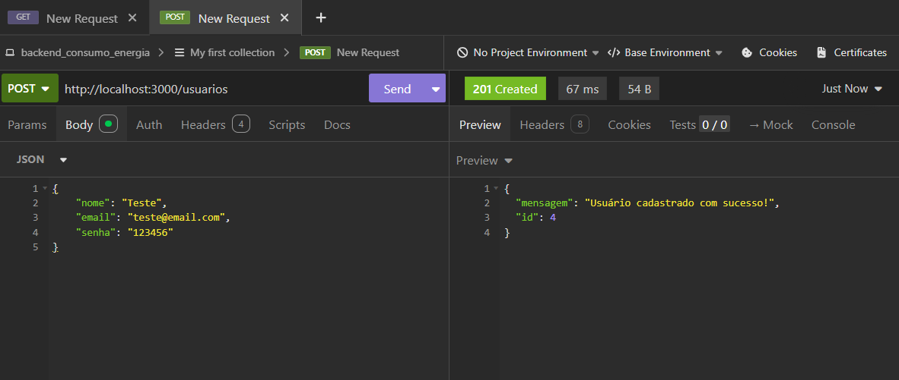

2. Listar usuários

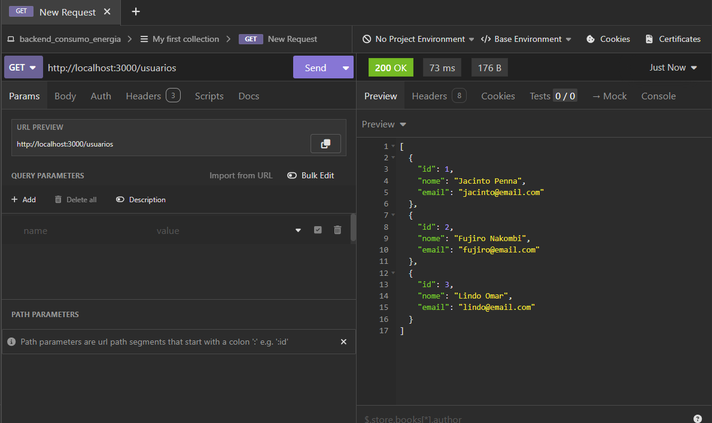

3. Buscar usuário

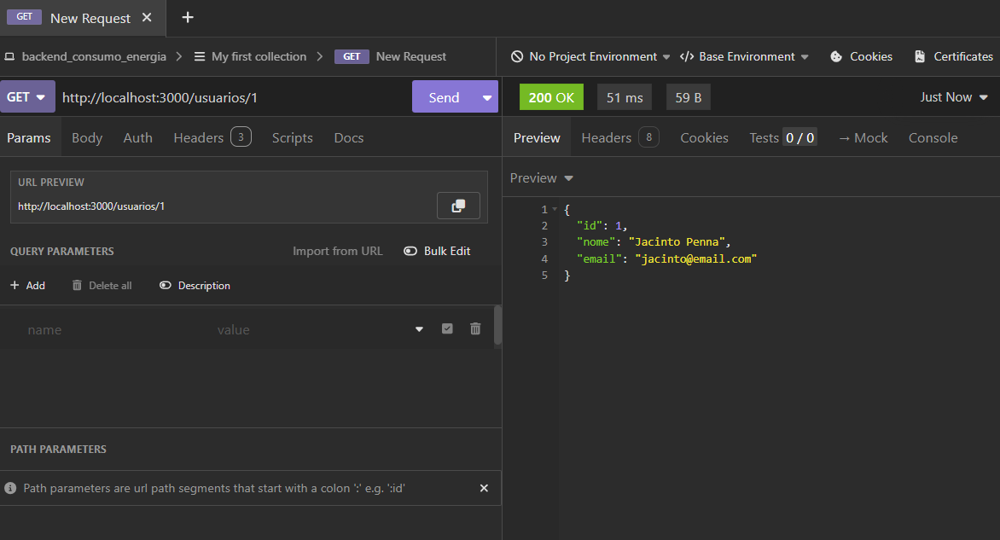

4. Atualizar usuário

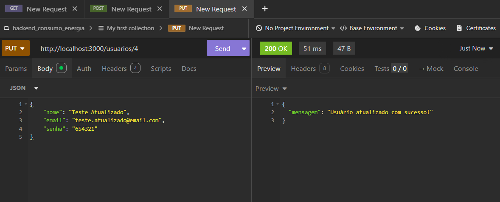

5. Login

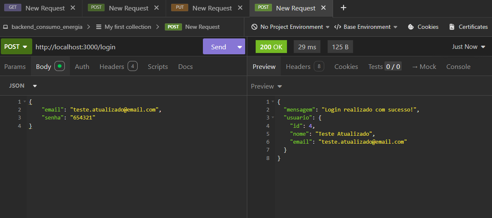

6. Excluir usuário

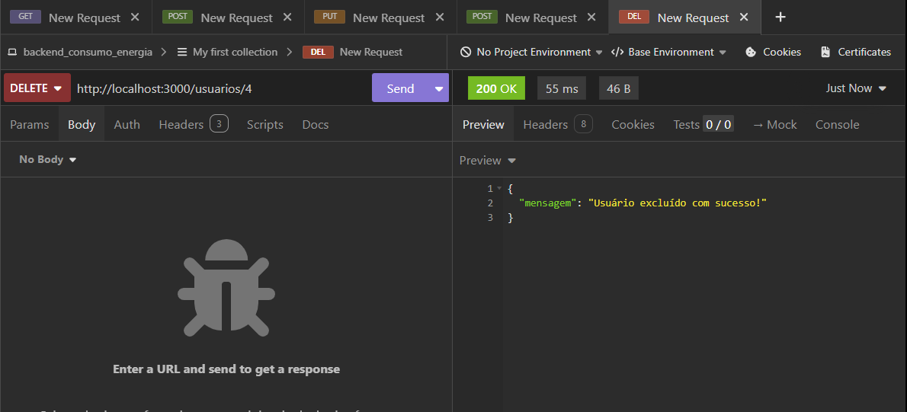

### Consumo

7. Cadastrar consumo

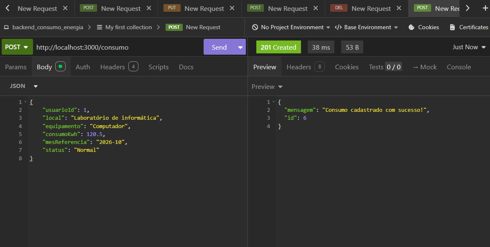

8. Listar consumos

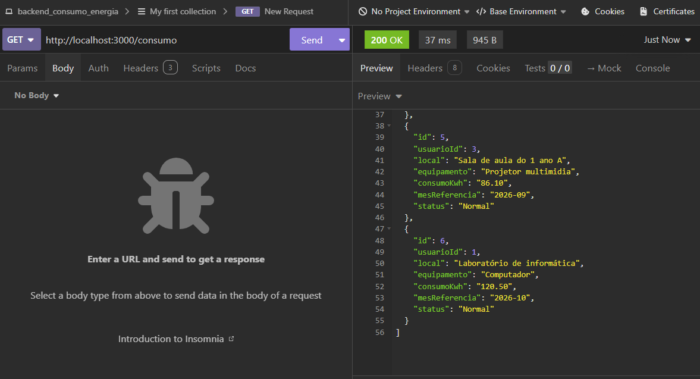

9. Buscar consumo

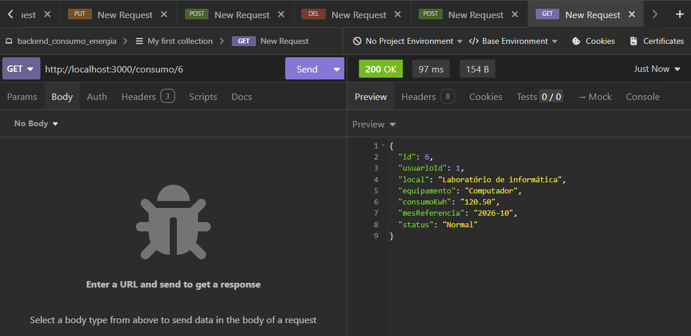

10. Atualizar consumo

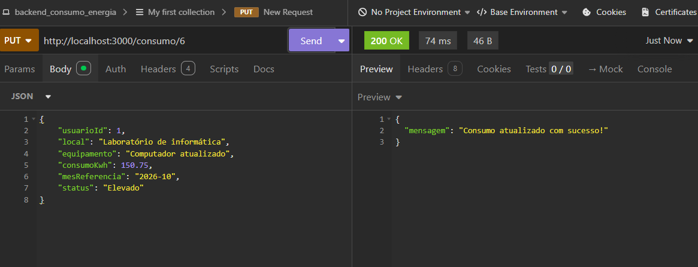

11. Verificar atualização

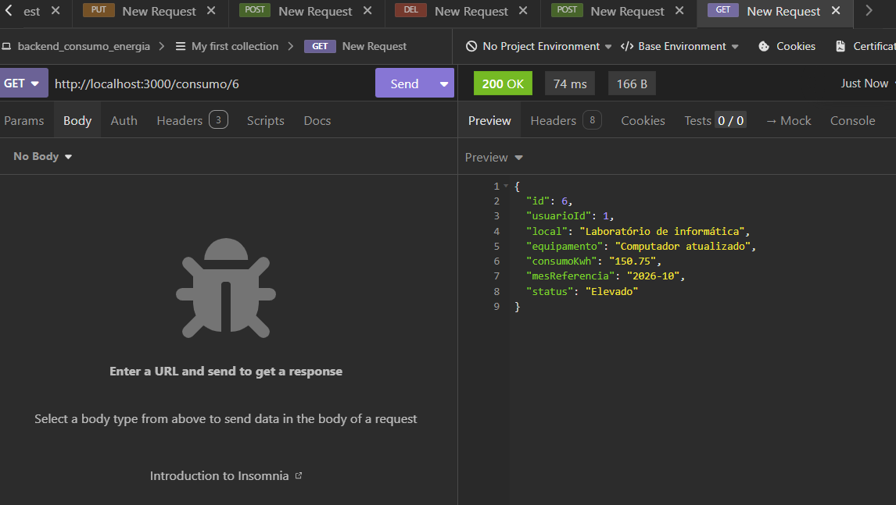

12. Média de consumo

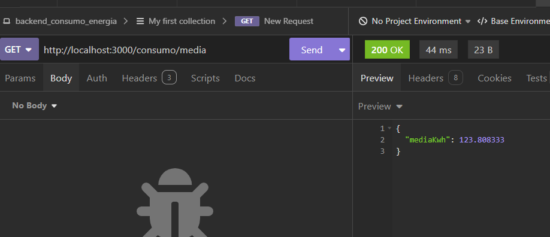

13. Excluir consumo

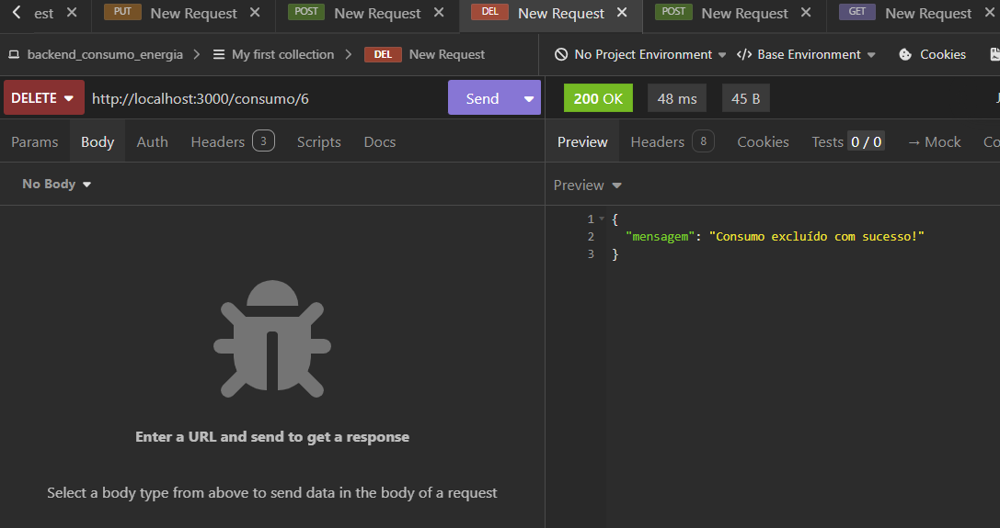

## Requisitos funcionais

- RF001 – CRUD de usuários.
- RF002 – Login.
- RF003 – CRUD de consumo.
- RF004 – Resumo contendo a média de consumo de energia em kWh.

## Autor
Projeto acadêmico desenvolvido como atividade de Programação Back-End.
